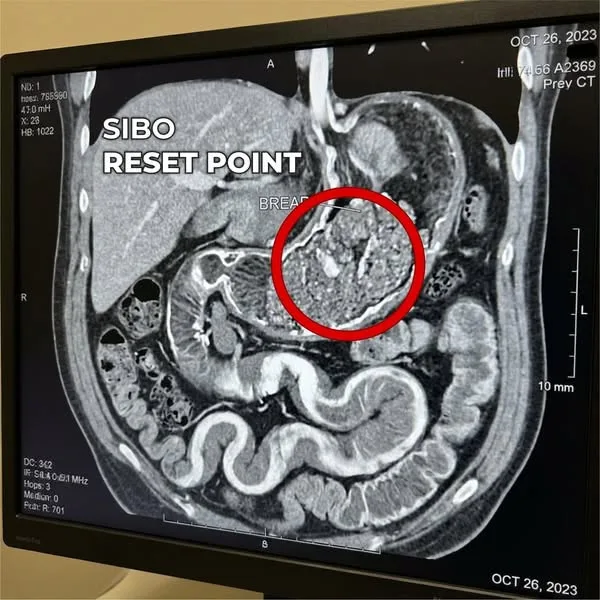
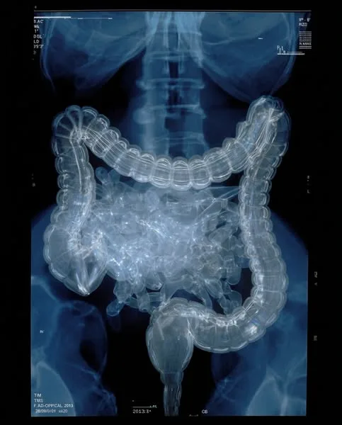
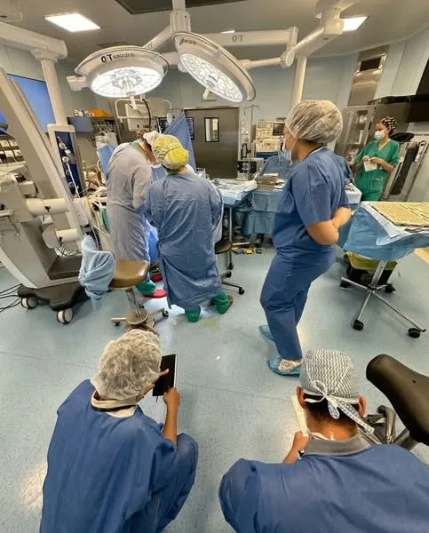
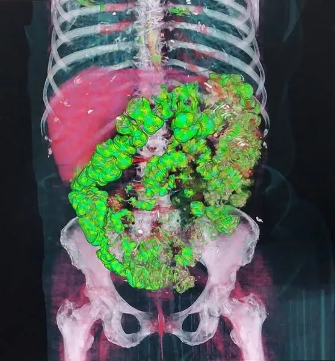

# Biora's top native ads (Meta Ad Library, Oct 14, 2026)

**Source.** Meta Ad Library, active US ads mentioning trybiora.com: about 330 live, 32 unique Biora ads collected. Ranking is the owner's final pick, informed by longevity and duplicate copies.

**Account pattern.**
- Every ad is a single image plus very long first-person copy (13,000+ characters), posted from persona pages: "Susan McBride", "Dr. Rachel Scott", "Jennifer Marsh, GI", "Holistic Healing with Nancy Stachera" and "Gut Health Community".
- All of them link straight to the product page. There is no advertorial in between.
- Images are medical scans, hospital scenes or candid phone photos. Never a product shot, except in the offer ads.
- 4 of the top 6 come from the "Susan McBride" persona and share one story world (the cruise and the Austrian ship doctor).

**Compliance note before reusing anything.** These ads lean on invented doctors and nurses, "IBS isn't real" disease claims and Bible "cures". Copying that is what gets ad accounts banned and brings FTC and FDA trouble. Borrow the story structures and angles, not the fake credentials or cure claims.

| # | Angle | Persona | Started | Library ID |
|---|---|---|---|---|
| #1 | The foreign-doctor travel crisis | Susan McBride | Sep 23, 2026 | [1111997128056214](https://www.facebook.com/ads/library/?id=1111997128056214) |
| #2 | The doctor who couldn't fix her own gut | Dr. Rachel Scott | Sep 19, 2026 | [1425429932898769](https://www.facebook.com/ads/library/?id=1425429932898769) |
| #3 | The Bible named the cure | Susan McBride | Sep 26, 2026 | [1984217668911761](https://www.facebook.com/ads/library/?id=1984217668911761) |
| #4 | The medication backlash (Imodium) | Susan McBride | Sep 23, 2026 | [2878517969173651](https://www.facebook.com/ads/library/?id=2878517969173651) |
| #5 | "I never had IBS at all" | Susan McBride | Sep 23, 2026 | [1074239948642258](https://www.facebook.com/ads/library/?id=1074239948642258) |
| #6 | The cruise story, rewritten with a new image | Susan McBride | Sep 28, 2026 | [3242029059335988](https://www.facebook.com/ads/library/?id=3242029059335988) |

## #1 · The foreign-doctor travel crisis

- **Page:** Susan McBride  
- **Library ID:** [1111997128056214](https://www.facebook.com/ads/library/?id=1111997128056214) · started Sep 23, 2026 · image ad → https://trybiora.com/products/biora-gut-complex-drops  
- **Angle:** A 56-year-old woman has a diarrhea crisis on a Mediterranean cruise. A European ship doctor asks her one question her American gastroenterologist never did, and that reframes "IBS" as a fixable root cause. A long first-person story; the product shows up late, as the thing she finally tried.  
- **Creative:** A candid phone photo of a cruise breakfast table by the window. No product, no text.  
- **Signal:** The most-duplicated ad in the account: 4 live copies of this story (Sep 23, Sep 28, Oct 8 ×2).


<details><summary>Full ad copy</summary>

```
I had a diarrhea crisis on a Mediterranean cruise. The ship's doctor was from Austria. She asked me ONE question that made my American gastroenterologist look 15 years behind.
I'm 56 years old.
My husband and I saved for two years for this cruise. Two weeks through the Mediterranean. Greece, Italy, Spain.
Day four, we're walking through Santorini.
Cobblestone streets. Steep hills. Beautiful.
But my stomach is churning. Four days into the trip, I've been running to the bathroom six, seven, eight times a day. The rich ship food, the late dinners, the schedule disruption, all of it has sent my gut into overdrive. The bloating is so bad that even loose clothes feel tight against my abdomen.
By the time we get back to the ship, I'm clenching everything I have. The cramping is sharp. I'm sweating through my blouse. My stomach is hard and swollen and I can feel the gas pressing against my insides.
My husband looks worried. "We need to get that looked at."
I don't want anyone looking at my belly. I haven't talked openly about the diarrhea in four years. Not with a friend. Not with a doctor I didn't have to see. Not with my husband in detail.
But the pain is bad enough that I don't have a choice.
The next morning, I go to the ship's concierge.
"I need to see a doctor about my stomach."
She makes a call. Gets me an appointment that afternoon with the ship's physician.
Her office is small. Clean. On Deck 3 near the medical center.
Dr. Weber. Austrian accent. Maybe mid-50s.
She examines my abdomen. Presses gently along the sides. Asks me to lie back.
"The immediate issue is the disruption from travel and unfamiliar food," she says. "But this is more than the cruise. How long have you been dealing with chronic diarrhea?"
"About five years," I say. "My gastroenterologist back home has me on Imodium. Every morning. Just to leave the house."
"Has she ever tested you for small intestinal bacterial overgrowth?"
I stare at her.
"What's that?"
She looks at me for a moment. Then sets down her stethoscope.
"Your gut doesn't malfunction on its own," she says. "In a huge number of chronic diarrhea cases diagnosed as IBS-D, what's actually happening is bacterial overgrowth in the small intestine. Your gut has a built-in cleaning cycle called the migrating motor complex — a wave that runs every 90 minutes between meals and sweeps bacteria downward and out. When that wave stops running, bacteria accumulate in the small intestine where they don't belong. They ferment your food before it's properly digested, producing hydrogen gas that speeds up gut motility and pulls water into the intestines. That's your urgency. That's your watery stool. That's why you can eat the blandest thing imaginable and your body still reacts."
"And the bigger issue is what years of Imodium does when the real problem is a stopped migrating motor complex. Each tablet slows the colon downstream, but the bacteria upstream keep fermenting. Keep producing gas. Keep pulling water in. The overgrowth grows. The symptoms get worse between doses. You need more tablets. They work less. The bacteria keep spreading. You're managing today's symptoms while the overgrowth that's causing them keeps getting worse."
I'm listening. But I don't understand why my gastroenterologist never explained this.
"My gastroenterologist never said anything about bacterial overgrowth."
Dr. Weber nods slowly.
"It's not commonly discussed in American GI practice," she says. "Most focus on anti-diarrheals and prescription escalation to rifaximin. But in Austria and Germany, we've been treating chronic diarrhea as a motility problem for over a decade. The bacteria aren't the original issue. The migrating motor complex stopping is. Restart the wave, and the bacteria clear on their own."
"So what do I do?" I ask.
"There's extensive research on restarting the migrating motor complex naturally," she says. "Specific gingerols found in ginger root have been shown in published clinical research to directly stimulate the wave — to get it running again. Once it's running, it does what it was designed to do. It sweeps the bacteria back down. But the delivery matters. Capsules rely on a damaged gut lining to dissolve and absorb. When the small intestine has been dealing with bacterial overgrowth for years, that lining is compromised. Liquid drops bypass that entirely. The compounds make direct contact. The research on this has been documented for years. American GI practice just hasn't caught up to it."
"My gastroenterologist never mentioned any of that."
"It's well-established in European clinical practice," she says. "But not standard protocol yet in the US. If I were you, I'd look into it when you get home."
She paused. Then added:
"Five years on a tablet that manages today's symptoms is not treatment. It's monitoring the decline."
I thank her and leave.
But I can't stop thinking about it.
For the rest of the cruise, it's in the back of my mind.
Five years. My gastroenterologist had been prescribing Imodium. Checking my labs every few months. Watching my dose creep from one tablet a day to two. Then three.
Telling me to keep taking it.
But she never once mentioned that my gut had a built-in cleaning cycle. That it had stopped running. That bacteria were accumulating in my small intestine and fermenting my food before my body could digest it.
Or that there was research on restarting it.
When we got home, I couldn't let it go.
The night we unpacked, I opened my laptop.
It was 11:45 PM.
I started searching.
"migrating motor complex SIBO"
"ginger gingerols gut motility research"
"small intestinal bacterial overgrowth IBS-D"
At 1:30 AM, I found it.
Peer-reviewed research. Published in clinical journals.
Study after study confirming exactly what Dr. Weber had told me. The migrating motor complex runs between meals and sweeps bacteria out of the small intestine every 90 minutes. When it stops, bacteria accumulate. They ferment food prematurely. They produce hydrogen gas that accelerates motility and pulls water into the intestines. Imodium slows the exit but doesn't restart the wave. Ginger gingerols at clinical concentration directly stimulate the migrating motor complex — published in Neurogastroenterology and Motility. And liquid delivery bypasses the damaged gut lining that capsules can't get through.
The research was there. Published. Peer-reviewed. Some of it over a decade old.
I read the studies three times.
I felt something rising in my chest.
Not anger. Something else.
Disbelief, maybe.
My gastroenterologist had been prescribing Imodium since 2019.
Five years.
And there was published research — from before she even started treating me — showing that the migrating motor complex stopping was the real problem, and that restarting it with specific compounds could address what Imodium never touched.
Why hadn't she mentioned it?
I kept reading.
More studies. European research. Clinical data.
All showing the same mechanism. Same results.
At 2:50 AM, I started looking for products.
Most gut supplements were useless. Probiotics that dump bacteria into a small intestine where the cleaning wave is still stopped. Ginger capsules that can't survive a compromised gut lining long enough to absorb. Generic digestive enzymes that do nothing for motility. None of it matched what the research showed was actually needed.
But I found one product built around this specific mechanism. Biora. Liquid drops. Ginger gingerols at the concentration the research used to stimulate the migrating motor complex. Compounds to clear the bacterial accumulation the stopped wave had allowed to build up. And support to repair the intestinal lining that years of overgrowth had damaged. All in liquid form, so it bypasses the compromised lining and actually reaches where it needs to go.
I read the reviews. Women describing exactly what I had been through. Years of Imodium that quieted the urgency for a few hours but never touched the cause. Then actual formed bowel movements. Normal mornings. Lives no longer planned around bathroom access.
I ordered a bottle at 3:15 AM.
When it arrived, I started immediately.
A full dropper in the morning. No Imodium before leaving the house. No low-FODMAP meal planning. No bathroom mapping.
Sixty seconds. Done.
Week one, the cramping I'd carried for years started quieting. Not gone. But different. Like something was finally reaching the right place.
Week two, I ate lunch one afternoon and nothing happened. No urgency. No running. The first time in five years. It happened again the next day. And again.
Week four, one normal bowel movement every morning. Formed. The bloating was gone by breakfast, not swelling until lunchtime. My pants fit. The hard, pregnant-looking abdomen was gone.
Week eight, I took a photo of my profile and compared it to one from two months earlier.
The difference was visible.
A flat belly by morning. Daily rhythm on my own. The cramping had stopped. The Imodium had dropped to nothing. No more dependency.
At three months, I went back to my regular gastroenterologist.
She reviewed my chart.
Then she stopped.
"Your symptoms have normalized," she said. "Actually, your bowel habits are significantly improved. That's unusual after five years of chronic IBS-D."
"I stopped the Imodium three months ago."
Her head came up. "You stopped?"
"I found something else. Liquid drops. Ginger gingerols to restart the migrating motor complex — the gut's cleaning wave. That's what was letting the bacteria accumulate in the first place. Once the wave started running again, the bacteria cleared. The diarrhea stopped."
My gastroenterologist looked at my chart.
"I'm not familiar with that approach," she said. "But the results speak for themselves. Keep doing whatever you're doing."
I left her office feeling something I hadn't felt in years.
Not angry. Not betrayed.
Just aware.
My gastroenterologist wasn't hiding anything from me.
She just didn't know.
The research existed. The studies were published. The results were documented.
But it wasn't part of her training. It wasn't standard protocol in American GI practice.
So she did what she was taught. Prescribe Imodium, monitor the symptoms, escalate to rifaximin if it gets severe.
Meanwhile, in Austrian and German clinics, they'd been treating chronic diarrhea as a motility problem — a stopped cleaning wave — for over a decade.
I'm 57 now.
My mornings are normal. One formed bowel movement. On my own.
And I think about that cruise ship doctor all the time.
The one who took ten minutes to explain what was actually happening in my gut. What the migrating motor complex was. Why it had stopped. Why the Imodium was managing the exit while the wave stayed stopped and the bacteria kept spreading.
Something my gastroenterologist had never mentioned in five years.
If your gastroenterologist is prescribing Imodium and telling you to "manage it" with no real improvement after months or years, you need to know something.
The research exists.
Published studies. Peer-reviewed clinical data. Showing that what's actually happening in chronic IBS-D is a stopped migrating motor complex — a gut cleaning wave that's no longer running — and that targeting the bacteria without restarting that wave is why Imodium and rifaximin keep failing. The bacteria come back because the wave that was supposed to prevent them from accumulating in the first place never restarted.
Your gastroenterologist probably hasn't seen this research.
Not because she's incompetent.
But because American GI training focuses on anti-diarrheals and antibiotic escalation. The migrating motor complex isn't part of that protocol.
So when she says "keep taking the Imodium," she's telling you what she was trained to recommend.
She's just not telling you that the wave stopped. Or that there's research on restarting it.
The brand I use is Biora. Liquid drops. A full dropper in the morning. That's it.
I don't get anything from sharing this.
I just know what it's like to take Imodium every morning for five years and plan your entire life around bathrooms.
And I know what it's like to have a doctor on a cruise ship — someone I met by accident because my stomach was in knots in Santorini — explain in ten minutes what my gastroenterologist never mentioned in five years.
If you're being told to just keep managing it, you deserve to know there's research your gastroenterologist might not have seen.
Research that could restart what actually stopped working in your gut. Without prescription escalation. Without antibiotic relapse cycles.
Research that's been understood in European clinics for over a decade.
You don't have to wait for your gastroenterologist to learn about it.
You can look into it yourself.
👉 https://trybiora.com/products/biora-gut-complex-drops
They also have a 90-day money-back guarantee. If your symptoms don't improve, full refund.
P.S. My husband took a photo of me in Santorini. Bent over a low stone wall, hand pressed against my stomach, while everyone else looked at the view. Last month, we went to dinner and I ate a three-course meal. He looked at me afterward and said, "You're not clenching." I'd been clenching for so long I didn't know I was doing it. I haven't clenched since I started taking Biora.
TRYBIORA.COM
Support Healthy Digestion Naturally
Biora, a complete microbiome support formula to soothe you digestion and pain.
Learn more
```

</details>

## #2 · The doctor who couldn't fix her own gut

- **Page:** Dr. Rachel Scott  
- **Library ID:** [1425429932898769](https://www.facebook.com/ads/library/?id=1425429932898769) · started Sep 19, 2026 · image ad → https://trybiora.com/products/biora-gut-complex  
- **Angle:** Insider confession: a "GI specialist" admits the standard playbook (low-FODMAP, avoid triggers, manage flares) didn't work on her own gut, then walks through the "real" cause (bacteria and biofilm buildup, a stalled cleaning wave) and the 4-step sweep.  
- **Creative:** A CT scan on a monitor with a red circle and the label "SIBO RESET POINT".  
- **Signal:** The oldest Biora ads still running (Sep 19). A second hook runs alongside it: the "late to a wedding" story (1775517127114569).



<details><summary>Full ad copy</summary>

```
I'm a GI specialist. I've been one for fourteen years.
I know what the inside of a gut looks like when it's failing. I've read ten thousand breath tests. I've prescribed low-FODMAP to hundreds of patients, written referrals for motility specialists, ordered colonoscopies and endoscopies and capsule studies that came back perfectly clean on paper.
I know this system.
And for three years, I couldn't fix my own gut.
That's the part I never said out loud at conferences. The part I didn't write in my patient notes. The part that kept me up at 3am wondering if I'd missed something obvious, or if the system I'd been working inside had missed it for me.
Here's what I'm going to tell you that most GI doctors won't.
The approach most of us learned in training, restrict the diet, avoid triggers, manage flares, doesn't treat what's actually causing chronic bloating and diarrhea in a significant portion of IBS-D patients. It treats the symptom. Not the source. There's a structural reason that approach persists. I'll get to it. But first I need to tell you what happened to me, because it's the only reason I started asking the questions that changed how I practice.
Three years ago I was eating twelve foods.
Twelve. I'm a doctor who specializes in the gut and I was surviving on white rice, plain chicken, carrots, zucchini, eggs, and a handful of other things I'd confirmed were safe, because anything else, anything with fiber, anything fermentable, any onion or garlic or bean or piece of fruit, would have me bloated within twenty minutes and in a bathroom within two hours.
I'd diagnosed myself with IBS-D eighteen months earlier, after ruling out everything else. Normal colonoscopy. Normal endoscopy. Normal bloodwork. Celiac negative. My own colleagues found nothing structurally wrong.
So I did what I tell my patients. Low-FODMAP diet. Strict adherence. Monash app. Meal prep every Sunday. No cross-contamination. No restaurant food.
Six months in, I was maybe 30% better. Still rushing to the bathroom. Still mapping every location I visited for bathrooms within two minutes of arrival. Still turning down dinner invitations I used to love.
Twelve months in, I'd added more restrictions. Cut all lactose. Cut resistant starches. Eliminated cold rice, reheated pasta, sweet potatoes. Each cut bought a small improvement. Enough to keep believing the next cut would finally fix it.
Still bloated by noon. Every single day.
Here's what bothered me as a clinician. I was following the protocol perfectly, and the protocol wasn't working. So I went back into the research, not the dietary management literature I knew cold, but the bacterial clearance studies nobody was talking about in standard GI practice.
53.3%. That's the prevalence of SIBO, small intestinal bacterial overgrowth, found in IBS-D patients across a meta-analysis of 50 published studies. More than half. In a Johns Hopkins study specifically, 63.4% of patients tested for SIBO came back positive. These aren't fringe numbers. They're sitting in the gastroenterology literature. Most patients never hear them because most gastroenterologists aren't ordering the test that would find them.
Your small intestine is supposed to be relatively sterile. The bacteria that help you digest food live downstream, in your large intestine, your colon. That's where fermentation belongs. When those bacteria migrate up into your small intestine, every meal becomes a fermentation event in the wrong place. They produce hydrogen gas too high up in your digestive tract. That hydrogen does two things: it accelerates gut motility, things move too fast, and it pulls water into the intestines. That's the diarrhea. That's the urgency. That's the bloating that hits twenty minutes after a meal even when the meal is plain rice and chicken.
Now here's the part that stopped me cold as a clinician.
Low-FODMAP works by removing the bacteria's preferred fuel sources. High-FODMAP foods, onions, garlic, beans, wheat, ferment rapidly. Eliminate them, the bacteria produce less gas, you feel somewhat better. But the bacteria are still there. They adapt. They start fermenting whatever you do eat, the white rice, the chicken, the carrots. Just slower. Just enough that you feel 30-40% better instead of well.
Think of it like a compost pile. Removing the banana peels doesn't remove the pile. It just slows the rot.
Every month on low-FODMAP without addressing the overgrowth, your microbiome diversity declines because you're not feeding beneficial bacteria. Your gut lining takes additional damage from the inflammation the overgrowth causes. You develop new sensitivities to foods that never bothered you before. The safe foods list doesn't shrink because you need to restrict more. It shrinks because the overgrowth is entrenching deeper while you try to outrun it.
I ordered a hydrogen breath test on myself the next morning. Positive. Hydrogen-dominant SIBO. Eighteen months of perfect restriction. Eating twelve foods. Still positive.
I sat in my own office and felt two things simultaneously: completely vindicated as a patient, and genuinely ashamed as a physician. Because the test I'd just ordered on myself was a test I should have been ordering on patients like me for years. And I hadn't. Because the protocol I'd been trained on didn't include it.
Before I tell you what I did next, I need to be honest about something that took me a long time to say out loud.
The GI medical system is not structurally incentivized to resolve chronic IBS-D. It's incentivized to manage it. A patient who achieves resolution doesn't need repeat appointments, follow-up colonoscopies, or ongoing dietitian referrals. A patient who is chronically managed, 40% better, stable, symptomatic enough to need continued care, generates a revenue stream. I'm not saying every GI doctor is consciously making this calculation. I wasn't. But the training, the guidelines, the referral loops all point toward dietary management, not bacterial elimination. And there's an entire industry, certified low-FODMAP products, meal delivery services, apps, coaching programs, that profits from you staying restricted. None of it profits from you getting better.
I went looking specifically for studies on bacterial clearance in SIBO. Not symptom reduction. Clearance, measured by follow-up breath testing, objective outcomes.
I found a study out of Johns Hopkins, published in Global Advances in Health and Medicine. It compared herbal antimicrobial protocols against Rifaximin, the leading prescription antibiotic for SIBO, the drug I had written prescriptions for and would have prescribed to myself. Herbal antimicrobials: 46% clearance rate on follow-up breath testing. Rifaximin: 34%. The herbs outperformed the drug. And 57.1% of patients who failed Rifaximin then cleared their SIBO using herbal therapy as rescue treatment. The prescription failed them. The herbs didn't.
I kept pulling research. Because I wasn't going to change how I practiced on one study.
The mechanism I kept returning to was gut motility, specifically a function called the Migrating Motor Complex. Your MMC is your gut's self-cleaning cycle. Between meals, it runs sweeping contractions that push bacteria downstream, from your small intestine toward your large intestine where they belong. A healthy MMC is what keeps bacterial populations from colonizing the small intestine in the first place. When the MMC is suppressed or weakened, by chronic stress, by certain medications, by inflammatory damage to the gut lining, bacteria accumulate. The sweep stops. Over weeks and months, you develop SIBO.
This is the mechanism low-FODMAP never addresses. It reduces bacterial fuel. It doesn't restore the sweep. The bacteria don't go anywhere. They just slow down and wait.
The research on restoring MMC function led me to four specific compounds. I want to explain each one plainly, because understanding why they work in sequence is what makes the difference between taking something and understanding what it's actually doing.
Ginger root extract, standardized to 20% gingerols. Gingerols are the active compounds that directly stimulate the MMC. Not ginger tea. Not ginger flavoring. Standardized extract at a verified concentration, because the research on MMC stimulation was done at therapeutic doses most ginger products never reach. When gingerols bind to specific receptors in the gut wall, they trigger the sweeping contractions the MMC is supposed to produce naturally. You're not reducing symptoms. You're restarting the mechanism that clears bacteria in the first place.
Artichoke leaf extract. Artichoke stimulates bile flow and accelerates gastric emptying. Slow transit time is one of the primary conditions that allows bacteria to accumulate in the small intestine. Bile is also naturally antimicrobial, one of the body's built-in defenses against overgrowth in the upper GI tract. When transit slows and bile flow decreases, you lose that defense. Artichoke restores both.
Berberine. This is where the actual bacterial rebalancing happens. Berberine has been studied across multiple clinical trials for antimicrobial activity against the specific bacterial species found in hydrogen-dominant SIBO, without the collateral damage of antibiotics that eliminate beneficial populations alongside the problem strains. It doesn't sterilize your gut. It selectively rebalances.
CoreBiome Tributyrin. SIBO causes direct damage to the intestinal lining. The villi, the tiny projections that absorb nutrients, flatten under chronic bacterial insult. That's why so many SIBO patients develop new food sensitivities and nutritional deficiencies even on restricted diets. The lining can't do its job. Tributyrin is a precursor to butyrate, the primary fuel for intestinal epithelial cells. CoreBiome is a specific form with clinical data on bioavailability that reaches the small intestinal lining where the damage is, not just the colon. It rebuilds the foundation so that as the overgrowth clears, the lining can actually repair.
Four compounds. One sequence. Ginger restarts the sweep. Artichoke improves transit and bile defense. Berberine rebalances the accumulated bacteria. Tributyrin repairs the damage so the system can function normally again. Not symptom management. Bacterial clearance and structural recovery.
My baseline hydrogen breath test: 42 parts per million at 90 minutes. Positive. Clear overgrowth. Week three: I ate something with garlic by accident, a restaurant sauce I hadn't vetted. Braced for what three years had taught me to expect. Mild discomfort. Nothing more. Week six breath test: 7 parts per million. Trending toward resolution. Week eight: I put the Imodium in the back of the medicine cabinet. Hadn't needed it in two weeks. Week twelve: follow-up breath test. 4 parts per million.
My gastroenterology colleague reviewed the results. "This is what resolution looks like," she said. "Not 40% better. Resolution."
I started reintroducing foods around week ten. Garlic first. Then onions. Then beans. Then bread. I've been eating normally for four months. No diarrhea. No urgency. No bathroom mapping. I go to restaurants now and I order off the menu and I don't calculate anything. I just eat.
I started running hydrogen breath tests on IBS-D patients who came to me already on low-FODMAP. The ones who fit the profile, restricted diet, still symptomatic, safe foods list shrinking. The SIBO positivity rate in that group was higher than I expected. I added the four-compound protocol for patients who tested positive, in liquid drop form, because absorption matters when the gut lining is compromised. Tablets and capsules require breakdown by a gut that isn't functioning properly. Liquid bypasses that entirely.
One patient I want to mention. Linda. 54 years old. On low-FODMAP for fourteen months when she came to me. Down to eighteen safe foods. Still having loose stools four to five times a day. Hydrogen breath test: 78 parts per million. Fourteen months of perfect restriction. Still positive. Still symptomatic. Eight weeks on the protocol: follow-up breath test, 11 parts per million. Diarrhea down to once daily, formed. Week twelve: she reintroduced garlic. No reaction. Onions. No reaction. "I cooked dinner last night," she told me at that appointment. "An actual dinner. For my husband. With garlic and onions. And we sat down together and I wasn't terrified." Fourteen months of restriction had not done what twelve weeks of bacterial clearance did.
The product I'm recommending to patients is Biora.
Most patients who go looking for this formulation hit the same wall I did: the supplement market for gut health is full of products with the right words on the label and none of the right ingredients inside. Ginger root on a label doesn't tell you the gingerol concentration. Berberine doesn't tell you the dose or the form. Most products combine these ingredients at doses too low to do anything meaningful, in forms that can't absorb properly through a damaged gut lining. Biora was formulated specifically around this mechanism, ginger standardized to 20% gingerols for MMC stimulation, artichoke at therapeutic dose for transit and bile support, berberine for bacterial rebalancing, CoreBiome Tributyrin for intestinal lining repair. Liquid drops, because a compromised gut lining can't reliably break down tablets. When my patients were sourcing these ingredients separately they were spending $300 to $400 a month with no guarantee of concentration or form. Biora puts the full mechanism in one formulation, at verified concentrations, in a form that actually reaches the small intestine.
If you've been on low-FODMAP for more than six months and you're still symptomatic, still bloated, still having diarrhea, still restricting and finding less relief with every cut, hear this clearly.
More restriction is not the next step.
The bacterial overgrowth causing your symptoms doesn't respond to restriction. It adapts. The safe foods list shrinks not because you need to find cleaner foods but because the overgrowth is getting worse and fermenting whatever you give it. The next step is clearance. You can stay on low-FODMAP during the first few weeks if it helps manage symptoms. But the goal shifts. You're not managing permanently, you're reducing fuel load while the mechanism does the actual work. Then you reintroduce. Slowly. And you find out what your gut can actually handle once the bacteria causing the problem are no longer there.
You're not broken. You've been given a symptom management strategy for a problem that requires bacterial clearance. Those are not the same thing, and the difference is everything.
**→** https://trybiora.com/products/biora-gut-complex
*These statements have not been evaluated by the Food and Drug Administration. This product is not intended to diagnose, treat, cure, or prevent any disease. Individual results vary. Consult your healthcare provider before beginning any supplement protocol.*
Speed Up Your Gut Again!
The four-step gut sweep that clears the bacterial buildup your diet and probiotics never touched.
Learn More
```

</details>

## #3 · The Bible named the cure

- **Page:** Susan McBride  
- **Library ID:** [1984217668911761](https://www.facebook.com/ads/library/?id=1984217668911761) · started Sep 26, 2026 · image ad → https://trybiora.com/products/biora-gut-complex-drops  
- **Angle:** Faith and ancient-wisdom angle: "The Bible named the cure for IBS over a dozen times. Your doctor has never read it." It builds mystery around one plant named in Exodus, Leviticus and Psalms (hyssop and oregano territory), then connects it to the formula. Aimed at a religious, older audience that distrusts modern medicine.  
- **Creative:** A blue X-ray-style scan of the colon. Clinical, no product.  
- **Signal:** Sister ad: "The same Bible that tells you not to eat pork also names the cure for parasites…" (1984191782269681, same day). Two variants of the angle launched together.



<details><summary>Full ad copy</summary>

```
The Bible named the cure for IBS over a dozen times. Your doctor has never read it.
The Bible called IBS "unclean" 3,000 years ago. It also named the fix. Your doctor hasn't.
I'm talking about a specific plant. Named in Exodus. Named in Leviticus. Named in Psalms.
Named every single time God told someone to make something unclean, clean again.
It's been growing on the same hills for three thousand years.
And the symptoms it was used for — the bloating, the diarrhea, the gut that won't stop punishing you.
Your doctor has a name for those now.
He calls it IBS. He hands you Imodium. He tells you to manage it.
The Bible had a different answer. Read every word of this.
"Do not eat the pig. It is unclean for you." That's Leviticus 11.
Most people read it and assume it was about holiness. A test of obedience. A rule with no reason behind it except to see if you'd follow.
It had a reason. A specific, physical, stomach-turning reason.
And the people who first heard that law could not have told you what it was, because the thing it guarded them from was too small to see.
Pigs carry worms.
Pork carries a parasite called trichinella, a worm that burrows out of undercooked meat and into the muscle of whoever eats it.
Pork also carries the tapeworm, which can grow many feet long inside a human gut and send its eggs to the brain.
Three thousand years before anyone owned a microscope, a desert people were told to stay away from the one animal most likely to put a worm inside them.
They did not know why. They just knew the families who ignored it got sick and the families who obeyed it did not.
And it was not only the pig.
"Whatever in the water does not have fins and scales is detestable to you." That's the next law.
Shrimp, crab, clams, the bottom feeders.
The ocean's scavengers, the ones that eat the filth and the dead things off the seafloor, the ones that concentrate every parasite and toxin in the water into their own flesh.
The law steered them away from the exact foods most likely to be crawling.
"Do not eat anything you find already dead." Carrion is a parasite nursery. The rule was a wall against it.
Then come the washing laws. Running water, not standing water.
Quarantine the sick for seven days, then seven more. Burn the clothes. Scrub the house.
An entire chapter of Leviticus reads like a field manual for stopping something invisible from spreading hand to hand and home to home.
Which is exactly what it was.
Every one of those laws was describing something specific, physical, and real.
A parasite.
The ancient world could not see them. But they had learned, the hard way, across generations of burying the people who got it wrong, exactly which foods and which habits let the worms in.
The food laws were a defense system against an enemy nobody could name.
And here is the part almost nobody has ever been told.
The same people who knew how to keep the worms out also knew how to get them out.
Open the Bible and you will find a plant that shows up every single time God needed something made clean.
Exodus 12. Leviticus 14. Numbers 19. Psalm 51. Over and over.
The same bitter herb, used for the same job. Its name is hyssop.
"Purge me with hyssop, and I shall be clean." That is Psalm 51.
It was the branch they dipped in blood at the first Passover.
It was the plant they used to clean the sick.
It was the herb God told them to reach for every time something unclean needed to be made clean again.
And many scholars believe it was a wild oregano that still grows on those same hills today.
The old world did not reach for it by accident. They reached for it because it WORKED.
And it was never used alone.
The bitter herbs of the Bible came in handfuls. Hyssop. The pungent oils. The bitter seeds. The sharp roots.
The old world reached for several of them at once, because they had learned that one plant was never enough to finish the job.
That is what I realized the night everything changed for me.
I have taught Scripture for 18 years.
Sunday mornings, Wednesday nights, a Bible study in my living room that outgrew my living room. I had read Leviticus more times than I can count.
I had stood in front of rooms full of people and explained the food laws as a lesson in obedience and never once thought about my own body.
Because for two years my own body had been falling apart, and I had no idea why.
It started with the bloating. Flat in the morning, looking six months pregnant by dinner.
Every. Single. Day.
Then came the diarrhea. Not the kind you get from bad food and forget about.
The kind that RUNS your life. Six, seven trips to the bathroom before lunch.
The kind where you memorize every restroom in every store.
The kind where you take an Imodium before you leave the house just to make it through errands without an accident.
I stopped eating out. Stopped accepting dinner invitations.
Stopped wearing anything fitted because by 4 PM my stomach looked like I was carrying a child.
My husband would ask if I wanted to go somewhere and I'd say no without even thinking about it. 
The bathroom math was already running in my head before he finished the sentence.
My doctor ran the tests. Found nothing. Told me it was probably stress. My age. My nerves.
"A woman of faith carrying too much," he said. Pray about it.
I did pray about it.
And one night I was at my kitchen table preparing a lesson on Leviticus 11, the food laws, the very chapter I had taught a dozen times, and I read the word unclean and for the first time in 18 years I understood it was not talking about my soul.
It was talking about my gut.
I sat there in the dark and read the whole thing again, the way I had never read it before.
The pork. The scavengers. The washing.
The hyssop that appeared every time something needed to be made clean.
And I understood that the Book I had taught my whole adult life had been describing my exact problem the entire time, and pointing straight at the remedy, and I had been too busy treating it as poetry to see it.
Context changes everything. Every single time.
Did you know that parasites cause the EXACT symptoms doctors keep calling IBS?
The bloating. The diarrhea. The cramping after meals. The urgency that comes out of nowhere.
Go on any forum. Go read the Reddit threads.
Thousands of people describing the same thing. "My doctor says it's IBS but nothing works." "I've tried every diet, every probiotic, every prescription." "I feel like something is WRONG and nobody will listen."
They are all describing the same problem. And most of their doctors never tested for it.
Did you know standard stool tests MISS most parasites? The CDC says it. Infectious disease doctors say it.
The tests look for the wrong thing, at the wrong time, in the wrong sample.
You can be crawling with them and test clean.
So your doctor shrugs and writes "IBS" on your chart and sends you home with a pill that slows your gut down while the thing CAUSING the problem keeps eating.
Did you know the food laws of Leviticus line up, almost one for one, with the foods we now know carry the most parasites?
The pig. The bottom feeder. The carrion. The blood.
Three thousand years ago they had the answer. We just stopped listening.
The old world did not have our science. It had something we lost. It had the roots.
And once you have those roots back, the answer that has been sitting in plain sight your whole life suddenly lands with the full weight it was meant to carry.
The remedy was never one plant. It was the handful, taken together.
Five plants. Each one with ONE job. Miss any of the five and the others fail.
That is why every single-ingredient parasite cleanse you have ever tried did NOTHING.
That is why the oregano oil capsule from Amazon did nothing.
That is why the black walnut tincture from the health food store did nothing.
One plant was never the answer. The old world knew that.
They buried enough people to learn this:
First: clove oil, one of the chief spices the old caravans carried, once worth its weight in gold. It strips the biofilm. That slimy shield parasites build around themselves so nothing can touch them.
Second: regano oil, the hyssop of Psalm 51. "Purge me with hyssop and I shall be clean." Many scholars believe that hyssop was wild oregano. It kills what the biofilm was protecting.
Third: black walnut hull, from the walnut grove the bride walks into in the Song of Solomon. It hits what oregano misses. Different kill angle. No escape route.
Fourth: ginger, used across every ancient culture on earth as the gut-moving herb. It restarts the wave in your gut that is supposed to push everything downward and out. When that wave stops, parasites anchor in. Ginger gets it moving again so they have NOWHERE to hold on.
Fifth: artichoke leaf, in the line of the bitter herbs of Passover. It flushes bile and keeps the gut sweeping after the parasites are cleared. So they do not come back.
Five plants. One job each.
Strip the shield. Kill what's hiding. Hit it from two angles. Restart the sweep. Keep it clean.
The exact strategy the old world used, because they had learned that hitting one part of the problem was the same as doing nothing.
I tried to do it myself. I ordered clove oil from Amazon. Black walnut tincture from a health food store. Oregano capsules. Ginger root from the grocery aisle.
I sat at my kitchen table with five different bottles and no idea how much of each to take, in what order, or whether any of them were even strong enough to do anything.
Two weeks in, nothing changed. The bloating was the same. The bathroom trips were the same. I was guessing at ratios the old world had spent generations figuring out, and I was getting it wrong.
I almost gave up. Almost went back to the Imodium and the doctor who told me to pray about it.
I was on some herb forum at midnight, reading a thread about clove and oregano dosing, and a woman in the comments said she had found a company that already figured out the ratios.
All five plants. Liquid drops.
She said she had been doing the same thing I was doing — buying everything separate, guessing amounts. And this was the first thing that actually worked.
The company was called Biora. A dropper in the morning. That was it.
Five plants. One job each.
Strip the shield. Kill what's hiding. Hit it from two angles. Restart the sweep. Keep it clean.
I took it the way the old world would have. The full handful, the full season.
Not one bottle and quit. Not two weeks and give up like every other thing I had tried.
By week 2, the bloating that had run my life for two years started going down for real.
Not the fake relief you get from cutting out bread for three days. Real.
My stomach was flat past dinner for the first time in so long I stood in front of the mirror and just looked at it.
By week 4, I ate a full meal and nothing happened. No run to the bathroom. No cramping. No clenching.
I sat at the table after everyone else had gotten up and I just sat there because I could not believe nothing was happening.
By month 2, one normal bowel movement every morning. Formed. No Imodium. No bathroom math. No saying no to dinner because I might not make it through the appetizer.
My pants fit. The hard swollen belly was gone.
By month 3, I had my body back. And the verses I had recited my whole life finally meant what they were always trying to tell me.
So here is what I will say to you, the way I wish someone had said it to me.
If your stomach swells up by the end of every day and no one can tell you why.
If you take an Imodium before you leave the house just to make it to the grocery store.
If you have tried the low-FODMAP diet, the probiotics, the elimination diet, the prescription your gastroenterologist swore would work, and NONE of it changed anything.
If three doctors have told you it is IBS, it is stress, it is your age, and a part of you has always known there is something underneath that they are not finding.
You are not crazy. You are not making it up. Your gut is not broken because you ate the wrong thing or stressed too much.
Something is living in there that should not be.
And the Book you may have read your whole life was pointing at the remedy three thousand years before the rest of the world caught up.
Biora is that old handful of bitter herbs, put back together the way they were always meant to be taken.
Liquid drops. Five plants. One job each. Nothing wasted.
It comes with a 90-day money-back guarantee. If nothing changes, you get every dollar back. You literally risk nothing.
The ancients did not avoid the worms by accident, and they did not clear them by accident either. They had the roots.
This puts those roots back in your hands.
You can check if they still have it in stock below. Biora is a small company and they run out a lot.
As far as I know, they are the only ones putting all five together in the right amounts.
👉 https://trybiora.com/products/biora-gut-complex-drops
P.S. My husband took a photo of me at our church potluck last Easter. I'm bent sideways in a folding chair, arms crossed over my stomach, while everyone else is eating. Last Sunday, we went to the same potluck and I ate two plates. He looked over at me and said, "You went back for seconds." I hadn't gone back for seconds in two years. I hadn't eaten at a table full of people without watching the clock or the door in even longer. He didn't say anything else. He just squeezed my hand under the table. That was enough.
TRYBIORA.COM
Support Healthy Digestion Naturally
Biora, a complete microbiome support formula to soothe you digestion and pain.
Learn more
```

</details>

## #4 · The medication backlash (Imodium)

- **Page:** Susan McBride  
- **Library ID:** [2878517969173651](https://www.facebook.com/ads/library/?id=2878517969173651) · started Sep 23, 2026 · image ad → https://trybiora.com/products/biora-gut-complex-drops  
- **Angle:** Fear of the current fix: "My gastroenterologist called it IBS-D and put me on Imodium. Five years later I collapsed. Not from the diarrhea. From the Imodium." The Austrian ship doctor from #1 then explains it in ten minutes. It turns the reader's daily coping drug into the threat.  
- **Creative:** A busy operating room shot from behind the medical team. Dramatic, hospital-feeling.  
- **Signal:** Same persona and story world as #1 (the ship doctor), which suggests they are building a series around the winning character.



<details><summary>Full ad copy</summary>

```
My gastroenterologist called it IBS-D and put me on Imodium. Five years later I collapsed.
Not from the diarrhea.
From the Imodium.
Three tablets a day. That's what it took just to leave the house.
Nobody told me what that dose was doing to my heart.
A ship doctor from Austria figured it out in ten minutes.
What she explained made five years of American GI visits look like a joke.
Read every word of this.
My name is Susan McBride. I'm 56 years old.
Something happened on a Mediterranean cruise that changed everything I thought I knew about my gut, my heart, and the pills I was swallowing every morning.
A ship doctor from Austria told me something my American gastroenterologist never mentioned in five years.
But before I get to that, I need to tell you something else first.
I was taking Imodium every single day.
It started with one tablet. Just enough to get through the morning. That was three years ago.
By last year I was up to three. Sometimes four.
Without it, my mornings looked like this.
Seven trips to the bathroom before 9 AM. Sometimes ten. Sometimes twelve.
I could go from solid and normal to thin as a pencil to piles of mush to pure liquid in about five minutes flat.
No warning. No pattern. Just chaos.
The Imodium didn't fix anything.
It just bought me a few hours where I could pretend to be a normal person who could leave her house.
My gastroenterologist prescribed Rifaximin.
She said it would clear the bacteria causing the diarrhea.
It cost over $1,400.
It worked. For about six weeks.
Then everything came back. Same urgency. Same bathroom math. Same clenching in the car.
She prescribed a second round. It barely touched it.
So I went back to Imodium. Higher dose now.
Three tablets before I even had breakfast.
That was my treatment plan. Take more pills and hope for the best.
Then something new started happening.
My heart would RACE out of nowhere.
Sitting on the couch watching TV. Lying in bed at 2 AM.
I could feel it pounding against my ribs. Skipping beats.
One night I woke up and my heart was beating so hard I put my hand on my chest and just held it there.
Like I was trying to keep it inside my body.
And it kept happening. Again and again. For months.
I told myself it was stress. I told myself it was my age. I told myself it was the coffee.
And then the cruise happened.
My husband and I had saved for two years for a Mediterranean cruise. Two weeks. Greece, Italy, Spain.
I packed more Imodium than clothes. I counted the tablets before we left.
Day four, we're walking through Santorini. Cobblestone streets. Steep hills. Beautiful.
But my stomach is done.
Four days of rich ship food, late dinners, no routine.
I took three Imodium that morning and it barely held.
The cramping is sharp. My abdomen is swollen and hard. I can feel the gas pressing against my insides.
Then it happens.
My heart starts POUNDING. Not like nerves. Not like anxiety.
Like something inside my chest is short circuiting. My vision gets narrow. My hands go numb.
I'm sweating through my blouse in the middle of a Greek island and my legs feel like they are about to give out.
I grab a low stone wall. My husband catches my arm.
This isn't my stomach.
Something is wrong with my HEART.
The next morning I go to the ship's medical center. Small office on Deck 3. Clean. Quiet.
Dr. Weber. Austrian accent. Mid-50s. She asks me what happened.
So I tell her everything.
The Imodium. Three tablets a day. Five years.
The seven trips to the bathroom every morning without it. Going from solid to pencil-thin to liquid in five minutes.
The Rifaximin that cost $1,400 and stopped working after six weeks.
And now the heart. The pounding. The skipping. The collapse on the island.
I tell her I have IBS-D.
That my gastroenterologist back home has been managing it for years.
That the Imodium is the only thing that lets me leave the house.
She sets down her stethoscope.
"I need to tell you something about what you're taking," she says. "Chronic high-dose loperamide, that's the active drug in Imodium, is documented to cause cardiac arrhythmia. Irregular heartbeat. The palpitations you described. The racing. The episode yesterday on the island. That is not stress. That is not your age. That is the Imodium damaging your heart rhythm."
I stare at her.
Five years. My gastroenterologist prescribed it. Watched my dose climb from one to two to three.
Never said a single word about what it was doing to my heart.
"I can't just stop," I say. "Without it I can't leave the room."
Dr. Weber nods.
"That's the real question," she says. "Not how to manage the damage from the Imodium. The question is why you need that much Imodium in the first place."
She leans forward.
"Has your gastroenterologist ever tested you for bacterial overgrowth in the small intestine?"
"No. She said it's IBS."
"It's not commonly investigated in American GI practice," she says. "In Austria and Germany, we've been treating this for over a decade. Your doctors aren't hiding it from you. They just haven't caught up yet."
Then she tells me something that changes everything I thought I knew about what was happening inside my body.
"Your small intestine has one job," she says. "Absorb what you eat. Nutrients. Vitamins. Everything. It absorbs all of it straight into your bloodstream."
"But when bacteria overgrow in the small intestine, and they've been growing in yours for years, they start eating your food before your body can digest it. That's the gas. That's the bloating. That's the diarrhea."
"But here's what no one told you. The diarrhea is the LEAST of your problems."
"Those bacteria produce toxic waste. Endotoxins. And your small intestine doesn't know the difference between a nutrient and a poison. It absorbs everything. So instead of absorbing vitamins from your meals, your gut has been absorbing bacterial poison. Directly into your blood. Every single meal. For five years."
"Your body has been treating this like a slow, continuous poisoning. Because that's exactly what it is."
I feel something drop in my chest.
"That's why it's not just diarrhea," she says. "The fatigue that sleep doesn't fix. The brain fog. The heart stress. The joint pain. It's all connected. All coming from the same place. Bacterial waste circulating in your blood."
"Standard blood panels don't test for circulating endotoxins. Your doctor ran labs, saw normal numbers, and told you everything was fine. But the test wasn't looking for what's actually wrong."
"Every time you eat, the bacteria eat first. They steal the nutrients. Then they release their waste. And your gut drinks it. That's been happening every meal for years."
I don't say anything for a long time.
Five years. My gastroenterologist had been handing me Imodium.
Watching my dose climb. Watching my heart symptoms appear.
Running blood panels that weren't even testing for the right thing.
And the whole time my gut was absorbing bacterial poison into my bloodstream with every single meal I ate.
"There's extensive research on clearing this," she says. "Stopping the bacterial overgrowth and the endotoxin production at the source. The research has been published for years. American GI practice just hasn't caught up to it."
She paused. Then added:
"Five years on a drug that's damaging your heart while your gut poisons your blood is not treatment. It's watching someone drown and handing them a towel."
I couldn't stop thinking about it for the rest of the cruise.
Every meal on that ship.
I'd sit there looking at my plate knowing that bacteria in my small intestine were going to eat it first. Steal the nutrients. Release their toxic waste.
And my gut was going to absorb that poison straight into my bloodstream. Again.
When we got home, I opened my laptop at 11:45 PM.
I started searching.
"bacterial overgrowth endotoxins bloodstream"
"small intestine bacterial waste absorption"
"IBS-D bacterial overgrowth misdiagnosis"
At 1:30 AM, I found it.
Study after study. Published in clinical journals. Peer-reviewed. Confirming exactly what Dr. Weber had told me.
Bacteria overgrow in the small intestine. They ferment food before the body can digest it. They produce endotoxins the small intestine absorbs directly into the bloodstream.
Continuous low-grade poisoning.
The fatigue. The brain fog. The heart problems. All documented.
All connected to the same source.
Some of these studies were published BEFORE my gastroenterologist even started treating me.
At 2:50 AM, I started looking for solutions.
Most of them were garbage.
Probiotics. They dump more bacteria into a small intestine that already has too many.
That's like throwing gasoline on a fire and calling it a fire extinguisher.
Ginger capsules. Packed with maltodextrin, inulin, chicory root. Fermentable fillers.
The bacteria EAT those ingredients.
Generic berberine tablets. Low purity. Weak absorption. Stuffed with the same fermentable junk.
None of it matched what the research said was actually needed.
Then I found something.
Five ingredients. One dropper. Nothing else.
I read what was in it and something clicked.
Phase 1. Clove oil dissolves the protective shield bacteria build around themselves to survive. Without breaking that shield first, nothing you throw at them gets through.
Phase 2. Ginger extract and artichoke leaf restart the gut's natural cleaning cycle. The wave that sweeps bacteria out of the small intestine. Without the wave running, anything you kill just gets replaced.
Phase 3. Two kill agents hit the exposed bacteria from two angles at once. Oregano oil. Black walnut hull.
Two different mechanisms. The bacteria can't resist both at the same time.
No maltodextrin. No inulin. No chicory root. No fermentable sugars. Nothing in the formula that bacteria can use as fuel.
I ordered 3 bottles at 3:15 AM.
When it arrived, I started immediately.
One dropper in the morning. No Imodium before leaving the house. No bathroom mapping.
Week 1, the cramping that had been my normal for five years started quieting. Not gone. But different. Like something was finally reaching the right place.
Week 2, I ate lunch and nothing happened. No urgency. No running. Just lunch.
It happened the next day too. And the day after that.
Week 4, one normal bowel movement every morning. Formed. Not mush. Not liquid. Formed.
The bloating was gone by breakfast. My pants fit.
Week 6, I realized I hadn't taken a single Imodium in over a month.
Week 8, the heart palpitations stopped.
That was the proof.
The bacterial poison in my blood was causing the diarrhea.
The Imodium I was taking to control it was destroying my heart.
Once the source was gone, I didn't need the Imodium. And the heart problems disappeared with it.
At 3 months, I went back to my gastroenterologist.
She reviewed my chart. Then she stopped.
"Your symptoms have normalized," she said. "That's unusual after five years of chronic IBS-D."
"I stopped the Imodium three months ago."
Her head came up. "You stopped?"
"I found something that clears the bacterial overgrowth directly. Stops the endotoxins at the source. My gut isn't absorbing poison anymore."
She looked at my chart.
"I'm not familiar with that approach," she said. "But the results speak for themselves. Keep doing whatever you're doing."
I left her office feeling something I hadn't felt in years.
Not angry. Not betrayed.
Just aware.
My gastroenterologist wasn't hiding anything from me. She just didn't know.
The research existed. The studies were published.
But it wasn't part of her training. It wasn't standard protocol in American GI practice.
So she did what she was taught. Prescribe Imodium. Watch the dose climb. Run blood panels that don't test for what's actually wrong. Prescribe Rifaximin when it gets bad enough.
Watch it relapse. Repeat.
Meanwhile, in Austrian and German clinics, they'd been treating this as a bacterial overgrowth and endotoxin problem for over a decade.
I'm 57 now.
My mornings are normal. One bowel movement. On my own.
No Imodium. No palpitations. No bathroom math.
The brand I use is Biora. Liquid drops. One dropper in the morning. That's it.
I don't get anything from sharing this.
I just know what it's like to take Imodium every day and feel your heart skip beats in the middle of the night.
I know what it's like to have your body absorb poison with every meal and not know it.
And I know what it's like to have a doctor on a cruise ship explain in ten minutes what five years of American GI visits never touched.
If your gut has been running your life and nothing has worked, you deserve to know there's research your doctor probably hasn't seen.
You can look into it yourself.
👉 https://trybiora.com/products/biora-gut-complex-drops
They also have a 90-day money-back guarantee. If your symptoms don't improve, full refund.
P.S. My husband took a photo of me in Santorini. Bent over a stone wall, hand on my chest, sweating through my shirt while everyone else looked at the view. Last month we went to dinner. Three courses. I ate all of it. No Imodium. No clenching. No palpitations. He looked at me afterward and said, "You look like yourself again." I didn't know I had stopped looking like myself. But he was right. I had.
TRYBIORA.COM
Support Healthy Digestion Naturally
Biora, a complete microbiome support formula to soothe you digestion and pain.
Learn more
```

</details>

## #5 · "I never had IBS at all"

- **Page:** Susan McBride  
- **Library ID:** [1074239948642258](https://www.facebook.com/ads/library/?id=1074239948642258) · started Sep 23, 2026 · image ad → https://trybiora.com/products/biora-gut-complex-drops  
- **Angle:** Misdiagnosis reveal: "I was diagnosed with IBS two years ago. I'm 44 now. Turns out I never had IBS at all." Two years of iron supplements, low-FODMAP diets and "learn to live with it", then the real cause. Speaks to anyone who feels labelled and dismissed.  
- **Creative:** A 3D CT rendering with the intestines glowing green, as if "full of bacteria". Shocking and scroll-stopping.  
- **Signal:** Launched Sep 23 with #1 and #4, the first batch from this persona, and still live.



<details><summary>Full ad copy</summary>

```
I was diagnosed with IBS two years ago. I'm 44 now. Turns out I never had IBS at all.
For two years, I "managed" a condition I didn't actually have.
Two years of iron supplements that made me nauseous every single morning.
Two years of low-FODMAP diets that left me miserable and still bloated.
Two years of being handed a prescription and told to "learn to live with it."
I did everything they asked.
I kept a food diary for a year and a half straight. Every meal. Every snack. Every symptom. Every bowel movement. I noted the time, my stress level, where I was in my cycle.
I did the low-FODMAP diet twice. Six weeks of no garlic, no onion, no wheat, no dairy. Plain chicken and rice while my husband ordered pizza.
When that didn't work, they tested me for celiac. Negative.
They sent me for a colonoscopy. Clean.
Endoscopy. Normal.
Blood work. "Your iron is marginally low. Keep supplementing."
"Everything else looks fine," my gastroenterologist said. "It's IBS. We've ruled out everything else."
He handed me another prescription for antispasmodics and told me to come back in six months.
I felt like a hypochondriac. Like maybe I was making it up. The tests were normal. The scopes were clean. But every single day, my body told me something was wrong.
By lunchtime, my stomach would start to swell. By dinner, I looked six months pregnant. By bedtime, I was on the couch with my jeans unbuttoned, too uncomfortable to move.
Then I'd wake up flat. And the whole thing would start again.
I mapped out bathrooms everywhere I went. Every store. Every restaurant. Every friend's house. I couldn't sit through a movie without knowing my escape route.
I stopped accepting dinner invitations. I never knew if I'd be okay or running to the toilet before the appetizers arrived.
I wore elastic waistbands to work because I couldn't predict what size I'd be by noon.
And every doctor just nodded. "That's IBS. Stress makes it worse. Have you tried managing your stress?"
I tried managing my stress. I tried yoga. I tried therapy. I tried gut-directed hypnotherapy at $200 a session because someone said it had clinical evidence.
I tried fourteen different probiotics. Digestive enzymes. Apple cider vinegar shots. L-glutamine powder every morning.
Nothing worked.
And meanwhile, my iron kept dropping. Ferritin at 13. Then 12. Then 11.
I was exhausted. Not tired. SHATTERED. My brain felt like it was running on 2% battery. I'd lose my train of thought mid-sentence. Forget words. I could picture the word in my head but couldn't get it out of my mouth.
My hair was falling out. Hands and feet like ice even in summer. Heart palpitations if I walked too much in a day. I used to have to stop on my walk home from work and eat a box of donuts just to get enough energy to make it the rest of the way.
My doctor treated the iron and the IBS like two completely separate problems. Iron pills for one. Low-FODMAP for the other.
The iron pills made my gut symptoms worse. More bloating. More cramping. More diarrhea. And after three months of high-dose iron? My ferritin had actually dropped several points.
So they moved me to iron infusions. Straight into the bloodstream through an IV. Bypassing my gut entirely. You'd think that would fix it.
My ferritin barely moved.
I started to believe this was just my body now. That I'd spend the rest of my life planning outfits around my stomach, declining invitations because I couldn't trust my own gut, and choking down iron pills that didn't work.
Then my neighbor asked me a question no doctor ever had.
She's a nurse. Works in a gastroenterology clinic. We were talking over the fence, and I was complaining about my stomach — I complained to anyone who'd listen at that point.
"When did your stomach problems start?"
I thought about it. About two years ago. Right around when I started my GLP-1 medication. My doctor and I had decided to try it for my weight and my blood sugar. Within a few months, everything changed. My stomach had never been the same since.
"And your iron — has it always been low?"
"It started dropping around the same time, actually. But my doctor says they're not related."
She shook her head. "They're not just related. They're the same thing."
I almost laughed. "My iron deficiency and my IBS are the same thing?"
"I'm telling you that you might not have IBS at all." She leaned against the fence.
"Think about it. That GLP-1 medication you're on — it works by slowing your digestive system down. Slower gastric emptying means food sits longer in your stomach, you feel full faster, you lose weight. That's the mechanism. Intended by design."
"But there's a cleaning cycle in your small intestine called the Migrating Motor Complex. The MMC. Every 90 minutes, when your stomach is empty, it runs a wave of contractions that sweeps bacteria downstream toward your large intestine where they belong. When GLP-1 slows your gut, it suppresses that wave. The cleaning cycle gets weak. Stops running on schedule. The bacteria that should be swept downstream stop moving."
"It's called SIBO. Small Intestinal Bacterial Overgrowth. When they digest your food, they release gas directly into your gut. That's your bloating. You wake up flat because they're less active overnight, then you eat breakfast and they go to work."
She wasn't done.
"The diarrhea? That's inflammation. Your immune system detects invaders, floods the area, speeds up transit time. It's trying to flush them out. But it can't, because the bacteria are anchored in there, multiplying. That's why it's unpredictable, urgent, uncontrollable. Some days three times. Some days eight. Your gut is fighting a war it can't win."
"What about the iron?" I asked.
Because that was the thing that scared me most. Ferritin at 11. Hair falling out. Heart palpitations from walking. Feeling like a dead body dragging itself through the day.
"They're stealing it," she said.
"Iron is absorbed in your small intestine — the exact place the bacteria have taken over. They're hungry for iron themselves. They grab it before your body gets a turn. And they've inflamed and damaged the gut lining so badly that even what gets past them can't get through the wall."
"That's why your ferritin drops even while you supplement. That's why the infusions barely worked — the systemic inflammation means your body still can't use the iron properly. Your doctor is treating two separate problems. The GLP-1 side effects and the iron deficiency. But it's one problem wearing two masks. The medication suppressed the cleaning wave. The bacteria moved in behind it. They're stealing your iron, fermenting your food, and destroying the lining that was supposed to absorb both."
I went home and couldn't stop thinking about it.
I Googled "SIBO iron deficiency" and fell into a rabbit hole I wasn't prepared for.
Study after study showing the link. SIBO damages the small intestinal lining. Iron absorption gets blocked. Ferritin drops even while supplementing. Same bacteria cause the bloating, the diarrhea, the urgency.
I found forum posts from women who sounded exactly like me. Diagnosed with IBS. Iron that wouldn't budge. Tried every diet. Every supplement. Every specialist. Tests always clean. Then they cleared the bacterial overgrowth. And everything changed.
I texted my neighbor the next morning: "Okay. Let's say you're right. What do I actually do?"
She called me on her lunch break.
"Here's the thing," she said. "The standard pharmaceutical treatment is a specialty antibiotic that costs over $1,000 without insurance. And the SIBO comes back the majority of the time. I've seen patients go through four, five rounds. Same result every time. Three weeks later, the bacteria are back, you're bloated again, your iron starts dropping, and you think the treatment failed. But really, the wave is still stopped and the bacteria just recolonized."
"So what works?"
"There's a protocol I've seen work in the clinic that a GI motility specialist has been recommending. Four compounds working together. Ginger root extract — standardized to 20% gingerols, not the ginger powder in a health food store capsule — directly stimulates the MMC. The cleaning wave. It tells your gut wall to fire the sweeping contraction again. When the wave runs, bacteria stop accumulating and start moving where they belong. Berberine HCl reduces the bacterial load selectively — it targets the overgrown species without wiping out the beneficial bacteria the way antibiotics do. Artichoke leaf extract restores bile flow. Bile is naturally antimicrobial — one of the defenses the small intestine loses when the cleaning wave stops running. And CoreBiome Tributyrin repairs the lining damage. The bacteria have been damaging the villi — the tiny projections that absorb iron and nutrients. Until the lining rebuilds, nothing absorbs the way it should. That's the piece every other protocol skips. That's why the iron finally comes back."
"Four compounds? In drops?"
"Liposomal liquid drops — not capsules. Your gut lining is already raw and damaged. A capsule has to dissolve and fight through a gut that's not working properly. Liposomal drops absorb on contact with your mucous membranes — directly into your bloodstream before your damaged gut has a chance to slow them down. The compounds actually reach the tissue that needs them. That's not a small detail. That's the difference between something that works and something that passes right through."
I looked it up immediately.
Biora. Four compounds at research-backed doses. Ginger standardized to 20% gingerols. Artichoke leaf extract. Berberine HCl. CoreBiome Tributyrin. Liposomal liquid drops. 90-day money-back guarantee. After two years of things that didn't help, what was one more try?
I started taking 2 dropperfuls a day.
On day four, my jeans buttoned easier.
Not comfortably. But easier. For the first time in months, I made it past lunchtime without the familiar pressure building in my gut.
By the end of week one, I realized I hadn't thought about my stomach in two full days.
Hadn't mapped a bathroom route before leaving the house. Hadn't checked my reflection sideways in the mirror.
That hadn't happened in two years.
Then came day twelve.
I went to the bathroom. One time. One normal, complete, easy movement.
I sat there afterward. Staring at the wall. Then the relief hit me. Then the fury.
For two years, I'd had urgent, unpredictable diarrhea. Some days three times. Some days eight. I'd mapped out every toilet in every building I'd ever entered. I'd stopped going to restaurants. Stopped going to movies. Stopped trusting my own body enough to pass gas without worrying.
And in twelve days, this was the first normal movement I'd had in two years.
"Keep taking your iron supplements," they said.
"Try a low-FODMAP diet," they said.
"Learn to live with it," they said.
Nobody asked when my gut problems started. Nobody connected the medication. Nobody tested for SIBO.
Over the next two weeks, the bloating disappeared completely. The diarrhea stopped. The urgency was gone. For the first time in two years, I ate pasta at a restaurant and didn't spend the next three hours paying for it.
By week three, my hands were warm. I noticed it making coffee. My fingers wrapped around the mug and I realized — I wasn't holding it for warmth. My hands were already warm. Pink. Not grey.
My hair stopped falling out. The clumps in the shower drain were gone.
Week four, I went for bloods. Terrified. Two years of ferritin going nowhere. But something felt different.
I opened the app. Scrolled to ferritin. Held my breath.
Ferritin: 34.
I stared at the screen. Refreshed it. Same number.
1. Up from 11. Without changing my iron intake at all.
Same iron in my diet. Completely different absorption.
I don't have IBS. I never had IBS.
I had SIBO. For two years. And nobody thought to check.
The bacteria were stealing my iron. Destroying the gut lining that absorbs it. Fermenting my food and pumping out gas. Causing the bloating, the diarrhea, the urgency. And wrecking my iron absorption at the same time.
Two problems. One cause. And nobody connected them.
My ferritin is 48 now. My gut is calm. My energy is back. My brain works. My hair is growing back.
I take 2 dropperfuls of Biora every day. That should be standard care for every woman on a GLP-1 medication whose iron won't budge and whose doctor keeps calling it "IBS."
If you've been diagnosed with IBS…
If you've tried the diets and the supplements and the prescriptions and nothing has worked…
If your tests keep coming back normal but you know something is wrong…
If your iron keeps dropping no matter what you take and nobody can tell you why…
I'm not saying you definitely have SIBO.
But I spent two years treating a condition I didn't have while the real problem multiplied inside my gut.
Biora uses liposomal liquid drops — not harsh capsules that add fuel to an already damaged gut. The ginger restarts the cleaning wave. The berberine selectively reduces the bacterial load. The artichoke restores bile flow. The tributyrin repairs the lining so iron can actually absorb again. It reaches your bloodstream before it ever hits your damaged gut. Just 2 dropperfuls a day.
Research-backed dosage. Made with natural ingredients. No prescription needed. Free shipping. Antibiotic free.
90 days to try it. If nothing changes, full refund.
But if it works?
If you wake up on day four and your jeans button easier?
If by week two you stop planning bathroom routes?
If a month from now you're wearing fitted clothes and eating normally and your ferritin is finally climbing for the first time in years?
You'll wish you started two years ago.
I know I do.
https://trybiora.com/products/biora-gut-complex-drops
You don't have to keep managing a condition you might not even have.
TRYBIORA.COM
Support Healthy Digestion Naturally
Biora, a complete microbiome support formula to soothe you digestion and pain.
Learn more
```

</details>

## #6 · The cruise story, rewritten with a new image

- **Page:** Susan McBride  
- **Library ID:** [3242029059335988](https://www.facebook.com/ads/library/?id=3242029059335988) · started Sep 28, 2026 · image ad → https://trybiora.com/products/biora-gut-complex-drops  
- **Angle:** The same cruise and ship-doctor story as #1, with the copy reworked (about 60% the same text) and a different photo. This is how they iterate a winner: keep the story, test new openings and images.  
- **Creative:** A crowded cruise-ship buffet with an ocean view. Hints at the food trigger.  
- **Signal:** Copy and image test of #1, launched Sep 28.


<details><summary>Full ad copy</summary>

```
I had a diarrhea crisis on a Mediterranean cruise. The ship's doctor was from Austria. She asked me ONE question that made my American gastroenterologist look 15 years behind.
I'm Susan McBride, 56 years old.
My husband and I saved for two years for this cruise. Two weeks through the Mediterranean. Greece, Italy, Spain.
Day four, we're walking through Santorini.
Cobblestone streets. Steep hills. Beautiful.
But my stomach is churning. Four days into the trip, I've been running to the bathroom six, seven, eight times a day.
The rich ship food, the late dinners, the schedule disruption, all of it has sent my gut into overdrive.
The bloating is so bad that even loose clothes feel tight against my abdomen.
By the time we get back to the ship, I'm clenching everything I have. The cramping is sharp. I'm sweating through my blouse.
My stomach is hard and swollen and I can feel the gas pressing against my insides.
My husband looks worried. "We need to get that looked at."
I don't want anyone looking at my belly. I haven't talked openly about the diarrhea in four years. Not with a friend. Not with a doctor I didn't have to see. Not with my husband in detail.
But the pain is bad enough that I don't have a choice.
The next morning, I go to the ship's concierge.
"I need to see a doctor about my stomach."
She makes a call. Gets me an appointment that afternoon with the ship's physician.
Her office is small. Clean. On Deck 3 near the medical center.
Dr. Weber. Austrian accent. Maybe mid-50s.
She examines my abdomen. Presses gently along the sides. Asks me to lie back.
"The immediate issue is the disruption from travel and unfamiliar food," she says. "But this is more than the cruise. How long have you been dealing with chronic diarrhea?"
"About five years," I say. "My gastroenterologist back home has me on Imodium. Every morning. Just to leave the house."
"Has she ever tested you for small intestinal bacterial overgrowth?"
I stare at her.
"What's that?"
She looks at me for a moment. Then sets down her stethoscope.
"Your gut doesn't malfunction on its own," she says. "In a huge number of chronic diarrhea cases diagnosed as IBS-D, what's actually happening is bacterial overgrowth in the small intestine. Bacteria that belong in your colon migrate up into your small intestine where they don't belong."
"And here's the part that explains everything you've been dealing with. Your bile normally has a handle on it. Something your gut grabs onto to pull it back in and reuse it. That bacteria breaks the handle off. Once it's gone, the bile just keeps floating. Straight into your colon. And your colon treats it like an emergency the second it arrives. It floods with water and pushes everything out. Fast."
"That's your urgency. That's the watery stool. That's why you get no warning. Once that bile hits the colon without its handle, your body doesn't wait. It dumps everything."
I felt tears starting.
"And the reason the same breakfast gives you diarrhea one day and not the next? It was never about the food. It's about how much bacteria happened to be active that morning. More bacteria breaking handles off your bile, more unbound bile reaching your colon. Less activity, nothing happens. The food was never the variable."
"My gastroenterologist never said anything about bacterial overgrowth. Or bile."
Dr. Weber nods slowly.
"And the bigger issue is what years of Imodium does when the real problem is bacteria breaking the handle off your bile. Each tablet slows the colon downstream. But the bacteria upstream keep breaking handles. The unbound bile keeps flooding in. Imodium is trying to hold the door shut while the bile keeps kicking it open. The overgrowth grows. The symptoms get worse between doses. You need more tablets. They work less. The bacteria keep spreading. You're managing today's flood while the thing causing the flood keeps getting worse."
I'm listening. But I don't understand why my gastroenterologist never explained this.
"My gastroenterologist never said anything about any of this."
Dr. Weber nods slowly.
"It's not commonly discussed in American GI practice," she says. "Most focus on anti-diarrheals and prescription escalation to rifaximin. But in Austria and Germany, we've been treating chronic diarrhea as a bacterial overgrowth problem for over a decade. The bacteria aren't just irritating the gut. They're stripping your bile and turning every meal into a flood. Clear the bacteria, and the bile keeps its handle. The flooding stops."
"So what do I do?" I ask.
"There's a two-step approach that addresses it directly," she says.
She wrote it down.
"Step one. Oregano oil and clove oil to clear the bacteria. And clove oil does something most people never hear about. It breaks down the protective shield that bacteria build around themselves, so the antimicrobial can actually reach what's hiding underneath. Most things only kill what's exposed on the surface."
"Step two. Ginger and artichoke to restart your gut's own natural rhythm and flush out what's been cleared. Bacteria don't just build up randomly. Something usually slows your gut down enough to let them accumulate in the first place. If that part never gets addressed, the same overgrowth builds right back up."
"Find something that does both. That's the difference between a protocol that works for a few weeks and one that actually sticks."
She paused. Then added:
"Five years on a tablet that manages today's symptoms is not treatment. It's monitoring the decline."
I thank her and leave.
But I can't stop thinking about it.
For the rest of the cruise, it's in the back of my mind.
Five years. My gastroenterologist had been prescribing Imodium. Checking my labs every few months. Watching my dose creep from one tablet a day to two. Then three.
Telling me to keep taking it.
But she never once mentioned that bacteria in my small intestine were stripping the handle off my bile.
That the unbound bile was flooding my colon every time I ate. That my body was dumping everything because the bile was arriving without the thing that was supposed to pull it back.
Or that there was a way to clear the bacteria causing it.
When we got home, I couldn't let it go.
The night we unpacked, I opened my laptop.
It was 11:45 PM.
I started searching.
"SIBO bile acid diarrhea"
"bacterial overgrowth bile malabsorption"
"oregano oil clove oil SIBO"
At 1:30 AM, I found it.
Peer-reviewed research. Published in clinical journals.
Study after study confirming exactly what Dr. Weber had told me.
Bacteria in the small intestine strip the handle off bile acids. The unbound bile reaches the colon and triggers an immediate water flood.
That's the urgency. That's the watery stool with no warning.
Imodium slows the exit but never touches the bacteria that keep stripping the bile.
Oregano oil and clove oil clear the overgrowth and break the protective shield bacteria hide behind.
Ginger and artichoke restart the gut's own rhythm so the bacteria can't rebuild on the same ground.
The research was there. Published. Peer-reviewed. Some of it over a decade old.
I read the studies three times.
I felt something rising in my chest.
Not anger. Something else.
Disbelief, maybe.
My gastroenterologist had been prescribing Imodium since 2021.
Five years.
And there was published research, from before she even started treating me, showing that bacteria were stripping the handle off my bile and that clearing the overgrowth with the right compounds could stop the flooding that Imodium never touched.
Why hadn't she mentioned it?
I kept reading.
More studies. European research. Clinical data.
All showing the same mechanism. Same results.
At 2:50 AM, I started looking for products.
Most gut supplements were useless. Probiotics that dump bacteria into a small intestine already overloaded with bacteria. Oregano capsules with nothing to break the protective shield bacteria hide behind. Motility supplements with no real antimicrobial dose at all. One step without the other.
None of it matched what the research showed was actually needed.
But I found one product that had both steps in one formula. Biora. Liquid drops. Oregano oil and clove oil to clear the overgrowth and break through the bacterial shield.
Ginger and artichoke to restart the gut's own rhythm so the bacteria can't rebuild. Both steps. One dropper.
I read the reviews. Women describing exactly what I had been through. Years of Imodium that quieted the urgency for a few hours but never touched the cause. Then actual formed bowel movements. Normal mornings. Lives no longer planned around bathroom access.
I ordered 3 bottles at 3:15 AM.
When it arrived, I started immediately.
A full dropper in the morning. No Imodium before leaving the house. No low-FODMAP meal planning. No bathroom mapping.
Sixty seconds. Done.
Week one, the cramping I'd carried for years started quieting. Not gone. But different. Like something was finally reaching the right place.
Week two, I ate lunch one afternoon and nothing happened. No urgency. No running. The first time in five years. It happened again the next day. And again.
Week four, one normal bowel movement every morning. Formed. The bloating was gone by breakfast, not swelling until lunchtime. My pants fit. The hard, pregnant-looking abdomen was gone.
Week eight, I took a photo of my profile and compared it to one from two months earlier.
The difference was visible.
A flat belly by morning. Daily rhythm on my own. The cramping had stopped. The Imodium had dropped to nothing. No more dependency.
At three months, I went back to my regular gastroenterologist.
She reviewed my chart.
Then she stopped.
"Your symptoms have normalized," she said. "Actually, your bowel habits are significantly improved. That's unusual after five years of chronic IBS-D."
"I stopped the Imodium three months ago."
Her head came up. "You stopped?"
"I found something else. Liquid drops. Oregano and clove to clear the bacterial overgrowth that was stripping my bile. Ginger and artichoke to restart the rhythm so the bacteria couldn't come back. Both steps. That's what was missing."
My gastroenterologist looked at my chart.
"I'm not familiar with that approach," she said. "But the results speak for themselves. Keep doing whatever you're doing."
I left her office feeling something I hadn't felt in years.
Not angry. Not betrayed.
Just aware.
My gastroenterologist wasn't hiding anything from me.
She just didn't know.
The research existed. The studies were published. The results were documented.
But it wasn't part of her training. It wasn't standard protocol in American GI practice.
So she did what she was taught. Prescribe Imodium, monitor the symptoms, escalate to rifaximin if it gets severe.
Meanwhile, in Austrian and German clinics, they'd been treating chronic diarrhea as a bacterial overgrowth problem, clearing the bacteria that strip the bile and restarting the gut's own rhythm, for over a decade.
I'm 57 now.
My mornings are normal. One formed bowel movement. On my own.
And I think about that cruise ship doctor all the time.
The one who took ten minutes to explain what was actually happening in my gut.
How bacteria were stripping the handle off my bile. How the unbound bile was flooding my colon with no warning. How the Imodium was trying to hold the door shut while the bile kept kicking it open.
Something my gastroenterologist had never mentioned in five years.
If your gastroenterologist is prescribing Imodium and telling you to "manage it" with no real improvement after months or years, you need to know something.
The research exists.
Published studies. Peer-reviewed clinical data. Showing that what's actually happening in chronic IBS-D is bacteria stripping the handle off your bile, flooding your colon every time you eat, and that trying to slow the exit with Imodium without clearing the bacteria that keep stripping the bile is why nothing ever gets better.
The bacteria keep breaking handles. The bile keeps flooding. The Imodium keeps falling behind.
Your gastroenterologist probably hasn't seen this research.
Not because she's incompetent.
But because American GI training focuses on anti-diarrheals and antibiotic escalation. Bile stripping from bacterial overgrowth isn't part of that protocol.
So when she says "keep taking the Imodium," she's telling you what she was trained to recommend.
She's just not telling you that bacteria are stripping your bile. Or that there's research on clearing them and restarting the rhythm so they can't come back.
The brand I use is Biora. Liquid drops. A full dropper in the morning. That's it.
I don't get anything from sharing this.
I just know what it's like to take Imodium every morning for five years and plan your entire life around bathrooms.
And I know what it's like to have a doctor on a cruise ship, someone I met by accident because my stomach was in knots in Santorini, explain in ten minutes what my gastroenterologist never mentioned in five years.
If you're being told to just keep managing it, you deserve to know there's research your gastroenterologist might not have seen.
Research that could clear the bacteria that are stripping your bile and restart the rhythm that keeps them from coming back. Without prescription escalation. Without antibiotic relapse cycles.
Research that's been understood in European clinics for over a decade.
You don't have to wait for your gastroenterologist to learn about it.
You can look into it yourself.
👉 https://trybiora.com/products/biora-gut-complex-drops
They also have a 90-day money-back guarantee. If your symptoms don't improve, full refund.
- P.S. My husband took a photo of me in Santorini. Bent over a low stone wall, hand pressed against my stomach, while everyone else looked at the view. Last month, we went to dinner and I ate a three-course meal. He looked at me afterward and said, "You're not clenching." I'd been clenching for so long I didn't know I was doing it. I haven't clenched since I started taking Biora.*
TRYBIORA.COM
Support Healthy Digestion Naturally
Biora, a complete microbiome support formula to soothe you digestion and pain.
Learn more
```

</details>

## Other angles they're testing

- **"Your tests are normal, but you're not"** (Gut Health Community, Sep 27–28, 3 copies; [1122251750363267](https://www.facebook.com/ads/library/?id=1122251750363267)): breath tests can't see the real problem, an explanation of the gut's cleaning wave, then an offer static ("One drop a day keeps the diarrhea away", Buy 3 for $17.98).
- **Self-experiment with numbers** (Jennifer Marsh, GI, Sep 23 and 28): "I spent 90 days testing a gut protocol on myself…"
- **Diet myth-bust** (Jennifer Marsh, GI, Sep 23 and 24): "The low-FODMAP diet will not fix your IBS."
- **Amish folk remedy** (Dr. Rachel Scott, Sep 28): "In 1742, an Amish healer in Lancaster County brewed a tincture of wild oregano, clove, and black walnut hull…"
- **Nurse on Imodium** (Nancy Stachera, Oct 9, 2 variants).
- **Age / GLP-1 trigger** (Gut Health Community, Oct 4, 2 copies): "After 40, years of medication, or months on a GLP-1…"
- **Price-drop retargeting** (Gut Health Community, Oct 8): "When I dropped the price you didn't move… 65% off."

## Shared copy and angles (top 6)

Compared sentence by sentence:

| Pair | Identical sentences | What's shared |
|---|---|---|
| #1 & #6 | about 65% | Same story and the exact same hook. #6 swaps the explanation (#1: the gut's "cleaning wave" stopped; #6: bacteria "break the handle off" bile, so the colon floods) and the photo. A mechanism and image test. |
| #1 & #4 | about 13% | Same back half: the Austrian ship doctor visit, "your symptoms have normalized", "no Imodium before leaving the house". #4 bolts a new opening (the Imodium collapse) onto the proven ending. |
| #2, #3, #5 | under 1% | Original copy. Only the link is shared. |

There are also two more copies of the cruise story (Oct 8: 983455398135291 and 1879863430036567). Each is about 50–58% the same as #1 and #6, with a new image, so the cruise story is being rewritten repeatedly.

**Angle families**
- **The cruise story with the foreign doctor** (#1, #6, the two Oct 8 copies, and #4's ending): one story, many versions.
- **"Your doctor got it wrong"** runs under almost everything, from a different entry point each time:
  - #4: the medication is hurting you (Imodium).
  - #5: you were misdiagnosed.
  - #2: even the doctor admits it doesn't work.
- **Ancient / faith remedy** (#3, the Bible): the only top-6 ad on a different angle.

## Angle summaries

### 1. The cruise and the foreign doctor (#1, rewritten as #6 and the two Oct 8 copies)
- **Voice:** "Susan McBride", 56, has had chronic diarrhea for 5 years and takes Imodium every morning.
- **Hook:** a diarrhea crisis on a dream Mediterranean cruise, and a ship doctor from Austria asks ONE question that makes her American gastroenterologist "look 15 years behind".
- **Story:** sick in Santorini, she sees ship physician "Dr. Weber", who asks whether she's ever been tested for bacterial overgrowth in the small intestine. She never had. The doctor explains it: the gut's cleaning wave (the "migrating motor complex") stopped, bacteria pile up, and Imodium only slows things downstream while the cause keeps going.
- **Villain:** American GI care: Imodium, then rifaximin, "just manage it". "In Austria and Germany we've treated this as a motility problem for a decade."
- **Product:** she researches ginger gingerols, finds Biora as the one formula built around restarting that cleaning wave, and her GI is surprised at the follow-up ("your symptoms have normalized").
- **Close:** "I don't get anything from sharing this", the link, the 90-day guarantee, and a P.S. callback (bent over in Santorini, then a three-course dinner).
- **#6 variant:** the same story with a different explanation (bacteria "break the handle off" bile, so the colon floods with no warning) and a buffet photo.

### 2. The doctor who couldn't fix herself (#2)
- **Voice:** "Dr. Rachel Scott", a GI specialist of 14 years.
- **Hook:** "I know this system. And for three years, I couldn't fix my own gut."
- **Story:** she's down to 12 safe foods on low-FODMAP, and every test is normal. She admits the training playbook (restrict, avoid triggers, manage flares) treats symptoms, not the cause.
- **Explanation:** a stalled cleaning wave leads to bacterial buildup. Restricting food doesn't clear bacteria; they adapt, and the list of safe foods keeps shrinking.
- **Product:** a 4-compound "sequence": ginger 20% gingerols restarts the sweep, artichoke helps transit, berberine rebalances bacteria and tributyrin repairs the lining. "The product I'm recommending to patients is Biora."
- **Close:** "More restriction is not the next step. You're not broken." Short compared with the others, with an FDA disclaimer.

### 3. The Bible named the cure (#3)
- **Voice:** "Susan McBride" again, a churchgoer.
- **Hook:** "The Bible named the cure for IBS over a dozen times. Your doctor has never read it."
- **Story:** Leviticus "unclean" foods have a physical reason (parasites). Hyssop, as in "Purge me with hyssop" (Psalm 51), is "wild oregano". The ancients used a handful of bitter herbs together, never one.
- **Explanation:** five plants with one job each:
  - clove strips the biofilm;
  - oregano kills;
  - black walnut hits what oregano misses;
  - ginger restarts the cleaning wave;
  - a fifth finishes the job.
  That's why single-herb Amazon capsules "did nothing".
- **Product:** she found Biora through a woman in an herb forum. "The old handful of bitter herbs, put back together."
- **Close:** "You are not crazy… something is living in there", a 90-day guarantee, scarcity ("they run out a lot") and a P.S. (the church potluck: bent over last Easter, two plates this year).

### 4. The medication backlash (#4)
- **Voice:** "Susan McBride", the same cruise character.
- **Hook:** "My gastroenterologist put me on Imodium. Five years later I collapsed. Not from the diarrhea. From the Imodium."
- **Story:** three tablets a day, then racing and skipping heartbeats, then a collapse on the island. The ship doctor says high-dose loperamide is linked to heart arrhythmia, and asks why she needs that much Imodium in the first place.
- **Explanation:** bacterial "waste" leaks into the blood, causing fatigue, brain fog, heart stress and joint pain, and standard blood panels don't test for it.
- **Product:** a 3-phase process (clove breaks the shield; ginger and artichoke restart the wave; oregano and black walnut kill). By week 8 the palpitations stop and she doesn't need the Imodium.
- **Close:** the same ending as #1 ("I don't get anything from sharing this", the guarantee, the Santorini P.S.).

### 5. "I never had IBS" (#5)
- **Voice:** a 44-year-old woman, tied to GLP-1 use.
- **Hook:** "I was diagnosed with IBS two years ago… Turns out I never had IBS at all."
- **Story:** two years of everything (food diary, low-FODMAP twice, celiac test, colonoscopy) plus iron pills that made it worse while her ferritin kept falling. Hair loss, cold hands, palpitations. Her neighbor (who works in a clinic) asks the question no doctor did and links her gut to her iron problem.
- **Explanation:** bacterial overgrowth and a stalled cleaning wave block absorption. She was misdiagnosed and mismanaged.
- **Product:** the neighbor's 4-compound liposomal-drops protocol is Biora (ginger, artichoke, berberine, tributyrin). "I take 2 dropperfuls every day."
- **Close:** a "what if it works?" future-pace (jeans button easier by day four, no bathroom routes by week two), a 90-day refund, and "You don't have to keep managing a condition you might not even have."
